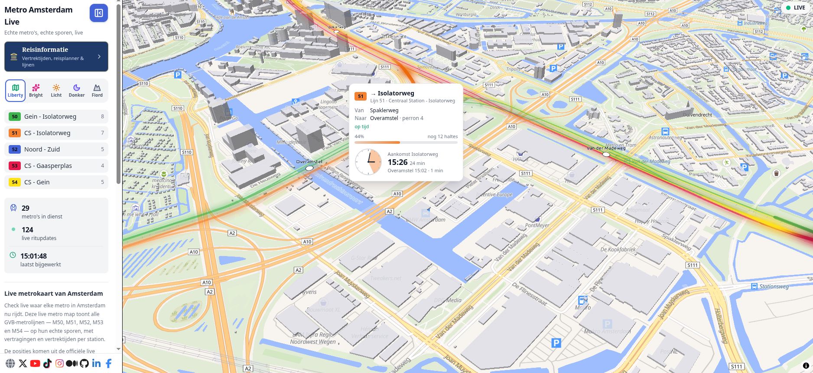

# 🚇 Amsterdam Metro Live

> **Live site:** [amsterdammetro.nl](https://amsterdammetro.nl) — a 3D, orbitable map of Amsterdam's GVB metro with real trains on real track geometry, in real time.



Built in the spirit of [londonunderground.live](https://www.londonunderground.live/) 🇬🇧 — but for Amsterdam 🇳🇱, with five map styles 🌗 and a full travel-info page 🧭 next to the live map.

---

## ✨ What it does

- 🚈 **Live trains** for all active GVB metro lines (50–54), positioned every few seconds from real GTFS-realtime data
- 🛤️ **Real track geometry** — trains ride the actual curves of the rails, not straight lines between stations
- 🏙️ **3D buildings** rendered from vector tiles, with an orbitable, pitchable camera (right-drag to spin around the city)
- ✅ **Confirmed stops**: where the signalling system reports a train at or heading to a station, that bounds its position; trains known only from the timetable are drawn fainter
- ⚠️ **GVB service messages** for the metro on the map, the station cards and the travel page, in Dutch or English
- ♿ **Accessible** (aiming at WCAG 2.2 AA): a text-version link as the first Tab stop, a station picker that needs no map, trains followable from the departure list, zoom and compass buttons instead of dragging, respect for "reduce motion", and spoken service messages
- 🌐 **Dutch and English**, switchable from the menu and the travel page header
- ⏱️ **Live delays** — see which trains are running late, straight from the same feed GVB itself uses
- 🚉 **Click a station** for a live departure board — next 8 trains, headsign, and countdown — with a link to its full travel info
- 🎯 **Click a train** to follow it with the camera; its card shows the next stop, delay, arrival time and **platform number**. On phones it has its own close button, and a tap on empty map stops following
- 💫 **Fading motion trails** behind every train, so movement reads at a glance
- 🌗 **Five map styles**: Liberty, Bright, Licht, Donker and Fiord. Each one drives the whole light or dark look, and your pick is remembered across visits
- 🎬 Opens with a cinematic fly-in, landing right on the busiest, most building-dense part of the network

## 🧭 Reisinformatie: the travel-info page

A second page at **[amsterdammetro.nl/reisinfo](https://amsterdammetro.nl/reisinfo)**, loaded only when you open it, so the map stays lean:

- 🕐 **Vertrekstaat**: departures per station, grouped by direction. It shows delays, cancelled runs, stops left and arrival at the terminus, with a 15–120 minute window and a walking-time filter
- 🔢 **Platform numbers** from the timetable: on the direction card, or per departure when a direction uses several platforms. The big interchanges (CS, Zuid, Sloterdijk…) have none in the official data, so none are shown there
- 🗺️ **Reisplanner**: direct and one-transfer journeys. The departure station also appears on the board
- 🚦 **Lijnen and Netwerkstatus**: line diagrams with the trains running right now, plus punctuality per line
- ♿ **Step-free stations**: a ♿ in station lists and search, step-free status on every station card with a link to GVB's lift faults, and an "avoid stairs" option in the planner that names any station on a journey that may need stairs. A station counts as step-free only once it is checked on GVB's station page; anything unconfirmed shows as not step-free. `scripts/seed-accessibility.sh` adds OpenStreetMap's tag as a hint for checking. The data is checked regularly: see [docs/step-free-stations.md](docs/step-free-stations.md)
- ⭐ **Favourites, recent stations and shareable links** (`/reisinfo?station=Noord&van=Noord&naar=Gein`), kept only in your browser
- 🕰️ **A Dutch station clock** in Amsterdam time, and a **light/dark toggle** in the header
- 🔎 **Smart search**: "arena", "52", "cs naar zuid" or "dichtbij" for the nearest station
- ⌨️ **Keyboard shortcuts** (`/`, `F`, `P`, `?`, `Esc`). Letter keys can be switched off for speech-input users (WCAG 2.1.4)
- 📱 **Built for phones** with tabs. Going back to the map lands on the station you were viewing

## 🧠 How it works

Amsterdam's metro fleet — like London's — publishes **no GPS positions**. So instead of tracking trains directly, this app derives their position the same way [londonunderground.live](https://www.londonunderground.live/) does for the Underground:

1. 📦 **GTFS static** (daily, from [OVapi](https://gtfs.ovapi.nl/nl/)) gives us the metro routes, stations, timetables, and true track shapes
2. 📡 **GTFS-realtime `tripUpdates.pb`** (polled every ~30s) gives live per-station arrival/departure predictions for every active trip
   - **`vehiclePositions.pb`** (every 20s) has no GPS for the metro, but names the stop each train was last reported at or heading to
   - **`alerts.pb`** (every 2 min) carries GVB's KV15 service messages
3. 🧮 A **position solver** places each train along its track shape between its last departed and next predicted station — smooth, believable, live movement
4. 📤 Positions are **pushed to the browser over Server-Sent Events** (gzipped per client), so the map updates without polling. The browser pauses the stream in background tabs

Why a train sits where it does, and what that does and doesn't claim: **[docs/position-model.md](docs/position-model.md)**.

## 🛠️ Stack

| Layer | Tech |
|---|---|
| Backend | 🐍 FastAPI (Python) — GTFS ingest, realtime poller, position solver |
| Frontend | ⚛️ React + TypeScript + Vite |
| Map & 3D | 🗺️ MapLibre + deck.gl (`MapboxOverlay`, `PathLayer`, `TripsLayer`) |
| Data | 🚏 OVapi / openOV (free, fair use) |
| Tiles | 🌍 OpenFreeMap (Liberty, Bright, Positron, Dark, Fiord) |
| Tests | 🧪 pytest (synthetic GTFS, no network) · Vitest + Testing Library · GitHub Actions |

## 🚀 Run it locally

```bash
# Backend (Python 3.12+); on Windows use .venv/Scripts/ instead of .venv/bin/
cd backend
python -m venv .venv && .venv/bin/pip install -r requirements.txt
.venv/bin/python -m uvicorn app.main:app --port 8020

# Frontend
cd frontend
npm install
npm run dev   # → http://localhost:5183 (proxies /api to :8020)
```

**Tests** (also run on every pull request by GitHub Actions):

```bash
cd backend && .venv/bin/pip install -r requirements-dev.txt && .venv/bin/python -m pytest
cd frontend && npm test
```

**Production preview locally** (optional):

```bash
cd frontend
cp .env.production.example .env.production.local
# edit VITE_API_URL if your backend runs elsewhere
npm run build && npm run preview
```

Production domain: **https://amsterdammetro.nl** (API: **https://api.amsterdammetro.nl**).

| Doc | Contents |
|---|---|
| [docs/domain.md](docs/domain.md) | DNS, registrar, env vars |
| [docs/render-deploy-plan.md](docs/render-deploy-plan.md) | Render deploy steps |
| [docs/costs-and-specs.md](docs/costs-and-specs.md) | RAM, bandwidth, pricing |
| [docs/legal-compliance.md](docs/legal-compliance.md) | Legal / attribution checklist |
| [docs/position-model.md](docs/position-model.md) | How train positions are derived |
| [docs/step-free-stations.md](docs/step-free-stations.md) | Step-free station data: the rule, sources, regular checks and log |
| [docs/privacy-policy.md](docs/privacy-policy.md) | Privacy policy (also at `/privacy`) |

First backend start downloads the national GTFS zip (~240MB, cached) and extracts the GVB metro subset — a few MB, refreshed daily.

## 💸 Running costs

No API keys, no paid services required:

| Item | Cost |
|---|---|
| Transit data (OVapi / NDOV) | Free |
| Map tiles (OpenFreeMap) | Free |
| Small VPS to host backend + frontend | ~€5–10/month |

Full breakdown (RAM, bandwidth, Render tiers): **[docs/costs-and-specs.md](docs/costs-and-specs.md)**.

## 🙏 Credits

Full attribution: **[docs/attribution.md](docs/attribution.md)** (also shown in the app sidebar).

- 🚇 **Transit data:** [OVapi](https://gtfs.ovapi.nl/) / [openOV](https://openov.nl/) / [NDOV](https://ndov.nl/) — GVB metro GTFS (not affiliated with GVB)
- 🗺️ **Map tiles:** [OpenFreeMap](https://openfreemap.org/) · [OpenStreetMap](https://www.openstreetmap.org/copyright) · [OpenMapTiles](https://openmaptiles.org/)
- 🧭 **Map engine:** [MapLibre GL JS](https://maplibre.org/) · [deck.gl](https://deck.gl/)
- 🎨 **Icons:** [Font Awesome](https://fontawesome.com/) by Fonticons, Inc.
- 💡 **Inspiration:** [londonunderground.live](https://www.londonunderground.live/) by Ben James

## 📄 License

MIT — see [LICENSE](LICENSE).
